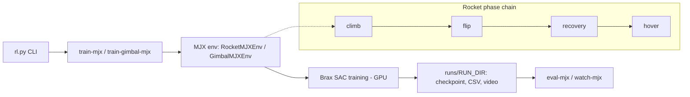

🇬🇧 English · 🇹🇷 [Türkçe](README.tr.md)

# 3D Rocket MJX RL

**A GPU-native MJX workspace that trains a TVC rocket's climb → flip → recovery → hover phase chain and a table-gimbal stabilization task with reinforcement learning.**

Training runs SAC on MuJoCo MJX / JAX; classic MuJoCo/SB3 files are kept only as reference utilities for comparison and visualization.


*TODO: add `assets/demo.gif` (under 10 MB) showing the phase chain.*

## Summary

| | |
|---|---|
| **Problem** | Learning the thrust-vector-control (TVC) rocket chain `climb → flip → recovery → hover` and a table-gimbal balance task |
| **Method** | MJX-based, GPU-native SAC training; unified CLI (`rl.py`) |
| **Simulation / hardware** | MuJoCo MJX, JAX/Brax, Python 3.11 |
| **Paper** | — (none yet) |

### System architecture

Unified CLI (`rl.py`) → `mjx/` (rocket environment + SAC train/eval) and `gimbal/` (table-gimbal environments). Details: [docs/README_ayrintili.md](docs/README_ayrintili.md) (Turkish/English notes).

### Flow diagram (how it works)



The policy is trained with Brax-SAC on GPU inside the MJX environment; the rocket task advances through a four-phase chain, outputs are collected under `runs/` and evaluated with the `eval`/`watch` commands.

## Selected results

*TODO: add `plots/sonuc_1.png` … (training curves, per-phase success rates). No published result plots yet; raw outputs are produced under `runs/` and are not tracked by git.*

*All figures will be kept in the `plots/` folder.*

## Installation

### Requirements
- Linux, Python 3.11 (for the pinned JAX/Brax/MuJoCo stack)
- GPU recommended (MJX)

### Steps
```bash
git clone https://github.com/GulogluHaktan/3DRocketRl.git
cd 3DRocketRl
python3.11 -m venv .venv-mjx
.venv-mjx/bin/python -m pip install -r requirements-mjx.lock
.venv-mjx/bin/python rl.py mjx-doctor
```

## Usage

```bash
# quick smoke training
.venv-mjx/bin/python rl.py train-mjx --total-env-steps 100000 --curriculum-stages 1 --num-envs 128 --run-dir runs/mjx_sac_smoke
.venv-mjx/bin/python rl.py eval-mjx --model runs/mjx_sac_smoke --episodes 1000
# table gimbal
.venv-mjx/bin/python rl.py train-gimbal-mjx --total-env-steps 8000000 --curriculum-stages 3 --num-envs 512 --run-dir runs/mjx_gimbal_sac_main
.venv-mjx/bin/python -m pytest -q
```
Expected output: checkpoints, step CSVs and videos under `runs/<run_dir>/`. Details: [docs/README_ayrintili.md](docs/README_ayrintili.md).

## Reproducing the results

| Figure | Command |
|---|---|
| `plots/sonuc_1.png` | TODO: `scripts/plot_1.py` not written yet |

## Project structure

```
3DRocketRl/
├── rl.py            # unified CLI
├── mjx/             # MJX rocket env, SAC train/eval
├── gimbal/          # table-gimbal envs and training code
├── assets/          # rocket MuJoCo XMLs, README images
├── algorithms/      # legacy SB3 algorithm wrappers
├── configs/         # example local configs
├── docs/            # technical notes
├── models/          # optional published model placeholders
├── tests/           # pytest
├── runs/            # generated outputs (git-ignored)
└── requirements*.txt / *.lock
```

## Citation, license, contact

```bibtex
@misc{rocketmjx2026,
  title  = {3D Rocket MJX RL},
  author = {Haktan G{\"u}lo{\u{g}}lu},
  year   = {2026},
  url    = {https://github.com/GulogluHaktan/3DRocketRl}
}
```
License: TODO. Contact: MTA Artificial Intelligence Center, Haktan Güloğlu.
