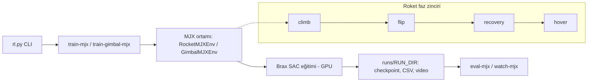

# 3D Rocket MJX RL

**TVC'li bir roketin climb → flip → recovery → hover faz zincirini ve masa-gimbal stabilizasyonunu GPU-yerel MJX ile pekiştirmeli öğrenmeyle eğiten çalışma alanı.**

MuJoCo MJX / JAX üzerinde SAC ile eğitim yapılır; klasik MuJoCo/SB3 dosyaları yalnızca karşılaştırma ve görselleştirme için referans olarak tutulur.


*TODO: `assets/demo.gif` — faz zincirini gösteren kısa kayıt (10 MB altı) eklenecek.*

## Özet

| | |
|---|---|
| **Problem** | Thrust-vector-control (TVC) roketinin `climb → flip → recovery → hover` zincirinin ve masa-gimbal denge görevinin öğrenilmesi |
| **Yöntem** | MJX tabanlı, GPU-yerel SAC eğitimi; birleşik CLI (`rl.py`) |
| **Simülasyon / donanım** | MuJoCo MJX, JAX/Brax, Python 3.11 |
| **Makale** | — (henüz yok) |

### Sistem mimarisi

Birleşik CLI (`rl.py`) → `mjx/` (roket ortamı + SAC train/eval) ve `gimbal/` (masa-gimbal ortamları). Ayrıntılar: [docs/README_ayrintili.md](docs/README_ayrintili.md).

### Akış şeması (nasıl çalışır)



Politika, MJX ortamında GPU üzerinde Brax-SAC ile eğitilir; roket görevi dört fazlı zincir olarak ilerler, çıktılar `runs/` altında toplanır ve `eval`/`watch` komutlarıyla değerlendirilir.

## Seçilmiş sonuçlar

*TODO: `plots/sonuc_1.png` … eklenecek (eğitim eğrileri, faz başarı oranları). Şu an yayımlanmış sonuç grafiği yok; ham çıktılar `runs/` altında üretilir ve git'e alınmaz.*

*Tüm şekiller `plots/` klasöründe tutulacaktır.*

## Kurulum

### Gereksinimler
- Linux, Python 3.11 (JAX/Brax/MuJoCo sabit sürümleri için)
- GPU önerilir (MJX)

### Adımlar
```bash
git clone https://github.com/GulogluHaktan/3DRocketRl.git
cd 3DRocketRl
python3.11 -m venv .venv-mjx
.venv-mjx/bin/python -m pip install -r requirements-mjx.lock
.venv-mjx/bin/python rl.py mjx-doctor
```

## Kullanım

```bash
# hızlı duman eğitimi
.venv-mjx/bin/python rl.py train-mjx --total-env-steps 100000 --curriculum-stages 1 --num-envs 128 --run-dir runs/mjx_sac_smoke
.venv-mjx/bin/python rl.py eval-mjx --model runs/mjx_sac_smoke --episodes 1000
# masa-gimbal
.venv-mjx/bin/python rl.py train-gimbal-mjx --total-env-steps 8000000 --curriculum-stages 3 --num-envs 512 --run-dir runs/mjx_gimbal_sac_main
.venv-mjx/bin/python -m pytest -q
```
Beklenen çıktı: `runs/<run_dir>/` altında checkpoint, adım CSV'leri ve videolar. Ayrıntı: [docs/README_ayrintili.md](docs/README_ayrintili.md).

## Sonuçları yeniden üret

| Şekil | Komut |
|---|---|
| `plots/sonuc_1.png` | TODO: `scripts/plot_1.py` henüz yok |

## Proje yapısı

```
3DRocketRl/
├── rl.py            # birleşik CLI
├── mjx/             # MJX roket ortamı, SAC train/eval
├── gimbal/          # masa-gimbal ortamları ve eğitim kodu
├── assets/          # roket MuJoCo XML'leri, README görselleri
├── algorithms/      # eski SB3 algoritma sarmalayıcıları
├── configs/         # örnek yerel ayarlar
├── docs/            # teknik notlar
├── models/          # opsiyonel yayınlanmış model yer tutucuları
├── tests/           # pytest
├── runs/            # üretilen çıktılar (git dışı)
└── requirements*.txt / *.lock
```

## Atıf, lisans, iletişim

```bibtex
@misc{rocketmjx2026,
  title  = {3D Rocket MJX RL},
  author = {Haktan G{\"u}lo{\u{g}}lu},
  year   = {2026},
  url    = {https://github.com/GulogluHaktan/3DRocketRl}
}
```
Lisans: TODO. İletişim: MTA Yapay Zeka Merkezi, Haktan Güloğlu.
